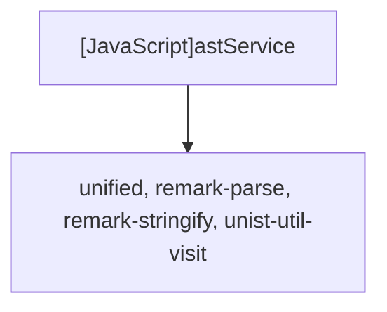

# [JavaScript]astService

## Overview
Provides AST manipulation functionality via `unified`, `remark-parse`, and `remark-stringify` to parse markdown, extract hierarchical sections, duplicate repeated blocks, substitute variables, and serialize clean markdown output.

## Dependencies & Impact Scope
### Dependency Diagram

### Impact Scope
* Directly governs the output Markdown structural integrity and content generation.

## Exported Functions

### (Function) `parseMarkdownToAst`
* **Description:** Parses a Markdown string into an MDAST syntax tree.
* **Arguments:**
  * `markdownText` (`string`): Raw markdown string.
* **Returns:** `object`

### (Function) `extractSections`
* **Description:** Parses MDAST root and extracts a hierarchical list of section metadata (headings and associated content nodes).
* **Arguments:**
  * `tree` (`object`): MDAST root node.
* **Returns:** `Array<{id: string, depth: number, title: string, startNodeIndex: number, endNodeIndex: number}>`

### (Function) `generateMarkdown`
* **Description:** Builds a target AST based on selected sections, repeat counts, and variable mappings, then serializes it to Markdown text.
* **Arguments:**
  * `rawMarkdown` (`string`): Original template markdown.
  * `selectedSectionIds` (`string[]`): Array of selected section identifiers.
  * `repeatConfigs` (`object`): Dictionary mapping section IDs to repetition counts.
  * `globalVariables` (`object`): Key-value pairs for global replacements.
  * `repeatVariables` (`object`): Key-value pairs indexed by repeat block and index.
* **Returns:** `string`
