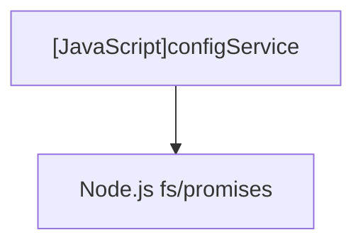

# [JavaScript]configService

## Overview
Manages loading, updating, and persisting configuration options (e.g. `lastOutputDir`, `defaultRepeatCount`) for the kctemp tool.

## Dependencies & Impact Scope
### Dependency Diagram

### Impact Scope
* Directly influences output directory default values in interactive prompts.

## Exported Functions

### (Function) `loadConfig`
* **Description:** Reads configuration from `config.json` or returns default configuration on missing/corrupted file.
* **Arguments:** None
* **Returns:** `Promise<object>`

### (Function) `saveConfig`
* **Description:** Persists updated configuration object into `config.json`.
* **Arguments:**
  * `newConfig` (`object`): Updated configuration key-value pairs.
* **Returns:** `Promise<void>`
