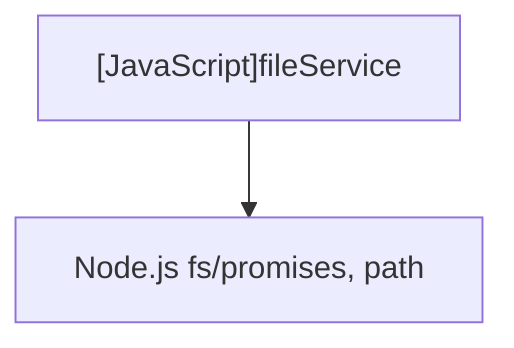

# [JavaScript]fileService

## Overview
Provides utility functions for file path resolution, checking file existence, generating sequential duplicate filenames, and writing output content safely with race condition prevention.

## Dependencies & Impact Scope
### Dependency Diagram

### Impact Scope
* Governs file creation, ensuring non-destructive output and safe duplicate resolution.

## Exported Functions

### (Function) `checkFileExists`
* **Description:** Checks whether the target file path already exists on disk.
* **Arguments:**
  * `filePath` (`string`): Absolute or relative file path to check.
* **Returns:** `Promise<boolean>`

### (Function) `generateSequentialName`
* **Description:** Generates a non-conflicting filename with incremented sequence number (e.g. `filename (1).md`).
* **Arguments:**
  * `targetDir` (`string`): Output directory path.
  * `baseFileName` (`string`): Original target filename.
* **Returns:** `Promise<string>`

### (Function) `ensureDirectoryExists`
* **Description:** Creates the target directory recursively if it does not exist.
* **Arguments:**
  * `dirPath` (`string`): Target directory path.
* **Returns:** `Promise<void>`

### (Function) `writeMarkdownFile`
* **Description:** Writes markdown content to the specified target path using exclusive write flag (`wx`) to prevent race condition overwrites.
* **Arguments:**
  * `filePath` (`string`): Target file path.
  * `content` (`string`): Markdown string to write.
* **Returns:** `Promise<void>`
