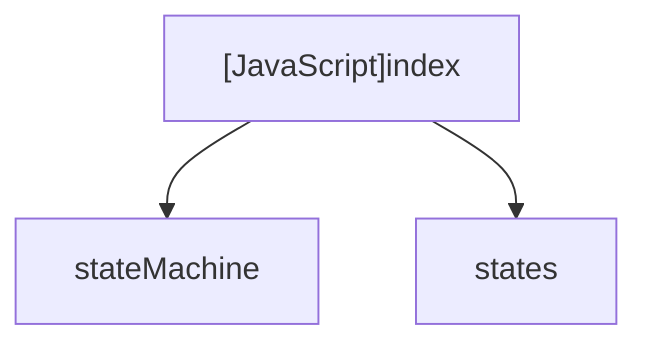

# [JavaScript]index

## Overview
Bootstraps the `kctemp` CLI application, sets up initial FSM context, and initiates execution.

## Dependencies & Impact Scope
### Dependency Diagram

### Impact Scope
* Serves as the core entrypoint invoked by `bin/kctemp.js` or `node src/index.js`.

## Exported Functions

### (Function) `main` (L4-16)
* **Description:** Initializes StateMachine with initial state `SELECT_TEMPLATE` and executes the run loop.
* **Arguments:** None
* **Returns:** `Promise<void>`