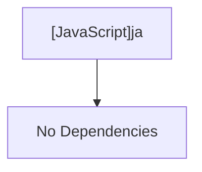

# [JavaScript]ja

## Overview
Provides centralized Japanese messages, prompt labels, and error text for the kctemp CLI application.

## Dependencies & Impact Scope
### Dependency Diagram

### Impact Scope
* Used across UI prompts, state handlers, and application logging.

## Exported Variables

### (Variable) `messages`
* **Type:** `object`
* **Description:** Hierarchical dictionary containing categorized UI text, prompts, and formatted error messages.
