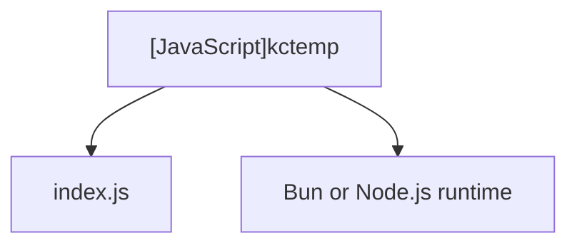

# [JavaScript]kctemp

## Overview
Serves as the executable CLI binary wrapper (`bin/kctemp.js`) invoked globally or locally. Checks runtime availability and delegates execution to `src/index.js`.

## Dependencies & Impact Scope
### Dependency Diagram

### Impact Scope
* Directly executed by user CLI invocations (`npx kctemp` or `kctemp`).

## Internal Variables

### (Variable) `isBun`
* **Type:** `boolean`
* **Description:** Indicates whether the current runtime environment is running under Bun.
