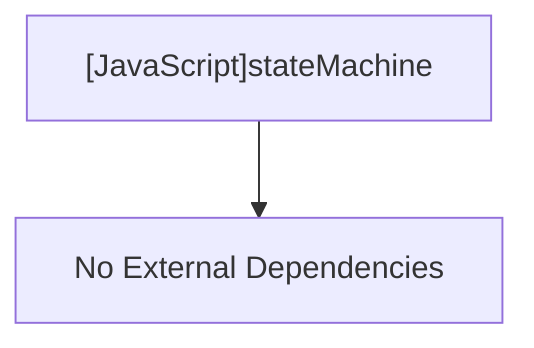

# [JavaScript]stateMachine

## Overview
Provides a generic, lightweight Finite State Machine (FSM) class that holds workflow context and executes state handlers sequentially using a trampoline loop to keep the call stack flat.

## Dependencies & Impact Scope
### Dependency Diagram

### Impact Scope
* Coordinates the lifecycle and navigation across all interactive CLI phases.

## Exported Classes

### (Class) `StateMachine` (L1-1)
* **Description:** Manages current state, context data, termination status, and transition execution.

#### (Method) `transitionTo` (L11-17)
* **Description:** Sets the next target state for the state machine execution loop.
* **Arguments:**
  * `nextState` (`string`): Target state name.
* **Returns:** `Promise<void>`

#### (Method) `run` (L19-40)
* **Description:** Starts state machine execution from the specified initial state using a flat trampoline loop until termination.
* **Arguments:**
  * `initialState` (`string`): Identifier of the state to start execution from.
* **Returns:** `Promise<void>`

#### (Method) `terminate` (L42-45)
* **Description:** Flags the state machine as terminated to stop any further state transitions.
* **Arguments:** None
* **Returns:** `void`
