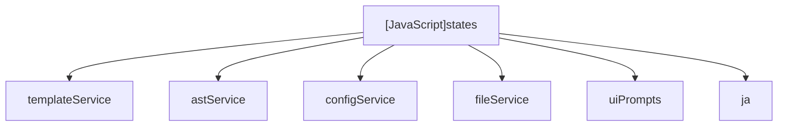

# [JavaScript]states

## Overview
Declares all state handler functions for the kctemp wizard (Template Selection, Section Selection, Repeat Setup, Variable Inputs, Output Path/Duplicate Resolution with EEXIST recovery, and Generation with isolated config error reporting).

## Dependencies & Impact Scope
### Dependency Diagram

### Impact Scope
* Directly drives the interactive flow presented to the user during command execution.

## Exported Variables

### (Variable) `STATES`
* **Type:** `object`
* **Description:** Enum-like dictionary of state identifiers (`SELECT_TEMPLATE`, `SELECT_SECTIONS`, `CONFIGURE_REPEATS`, `INPUT_VARIABLES`, `RESOLVE_OUTPUT`, `GENERATE_FILE`, `COMPLETE`).

### (Variable) `stateHandlers`
* **Type:** `object`
* **Description:** Map of state names to their async execution handlers taking the FSM context.
