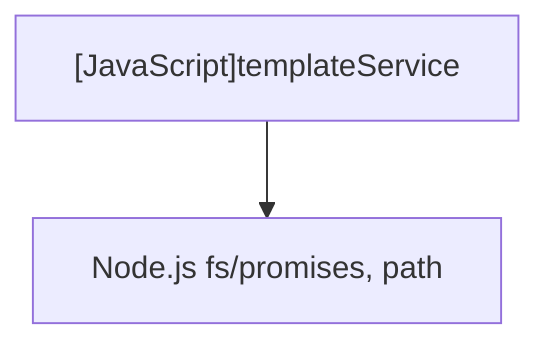

# [JavaScript]templateService

## Overview
Scans template directories, loads Markdown template files, and extracts variable placeholders (both bracketed `{マス}` and domain-specific patterns like `En`, `第n艦隊`).

## Dependencies & Impact Scope
### Dependency Diagram

### Impact Scope
* Determines available template list and variable input prompts presented to the user.

## Exported Functions

### (Function) `listTemplates`
* **Description:** Scans the templates directory and returns a list of available template file descriptors.
* **Arguments:**
  * `templatesDir` (`string`): Directory containing markdown templates.
* **Returns:** `Promise<Array<{name: string, path: string}>>`

### (Function) `readTemplate`
* **Description:** Reads and returns raw Markdown content from a given file path.
* **Arguments:**
  * `filePath` (`string`): Path to the template file.
* **Returns:** `Promise<string>`

### (Function) `extractVariables`
* **Description:** Extracts unique variable placeholder names from template text.
* **Arguments:**
  * `text` (`string`): Markdown text to analyze.
* **Returns:** `string[]`
