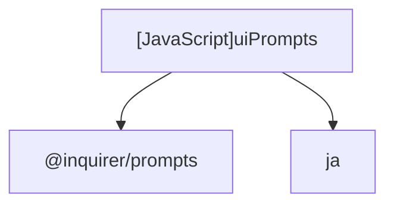

# [JavaScript]uiPrompts

## Overview
Wraps `@inquirer/prompts` methods (select, checkbox, input) using centralized messages from locale definitions.

## Dependencies & Impact Scope
### Dependency Diagram

### Impact Scope
* Directly affects terminal UI rendering and user interactions.

## Exported Functions

### (Function) `promptTemplateSelection` (L4-29)
* **Description:** Displays list of available templates and direct file path option.
* **Arguments:**
  * `templateList` (`Array<{name: string, path: string}>`): List of available templates.
* **Returns:** `Promise<string>`

### (Function) `promptSectionSelection` (L31-58)
* **Description:** Displays checkbox list of AST headings/sections with fallback for templates with no sub-headings.
* **Arguments:**
  * `sections` (`Array<{id: string, title: string, depth: number}>`): Section metadata.
* **Returns:** `Promise<string[]>`

### (Function) `promptRepeatCount` (L60-70)
* **Description:** Prompts user for repeat count of a specific section with strict positive integer validation.
* **Arguments:**
  * `sectionTitle` (`string`): Title of the section to repeat.
  * `defaultValue` (`number`): Initial default count.
* **Returns:** `Promise<number>`

### (Function) `promptVariableInput` (L72-80)
* **Description:** Prompts for single variable value replacement.
* **Arguments:**
  * `varName` (`string`): Name/key of the variable.
  * `description` (`string`): Helpful hint or description.
  * `defaultValue` (`string`): Default value if any.
* **Returns:** `Promise<string>`

### (Function) `promptOutputResolution` (L82-103)
* **Description:** Prompts for output directory and filename.
* **Arguments:**
  * `defaultDir` (`string`): Pre-filled directory path.
  * `defaultName` (`string`): Suggested base filename.
* **Returns:** `Promise<{outputDir: string, fileName: string}>`

### (Function) `promptDuplicateAction` (L105-127)
* **Description:** Asks user how to handle existing file conflict.
* **Arguments:**
  * `conflictPath` (`string`): Conflicting file path.
  * `autoCandidateName` (`string`): Candidate sequential filename.
* **Returns:** `Promise<'auto' | 'manual' | 'cancel'>`