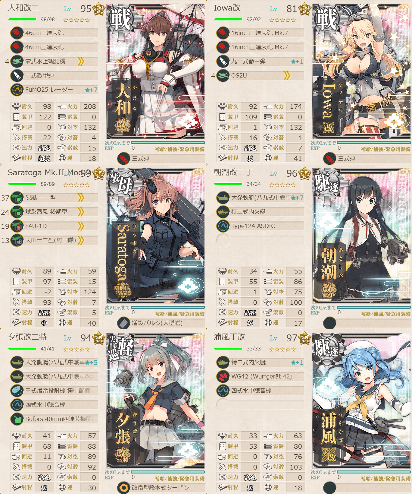

# 4-5 カレー洋リランカ島沖 深海東洋艦隊漸減作戦

> [!NOTE]
> 個人用攻略ログ

## 目次

<details>
<summary>クリックで展開</summary>

- [4-5 カレー洋リランカ島沖 深海東洋艦隊漸減作戦](#4-5-カレー洋リランカ島沖-深海東洋艦隊漸減作戦)
  - [目次](#目次)
  - [編成](#編成)
    - [T](#t)
      - [艦隊編成](#艦隊編成)
      - [所感](#所感)
  - [参考文献](#参考文献)

</details>

---

## 編成
### T
#### 艦隊編成



- **第1艦隊:**
```yaml
艦隊:
  - name: 大和改二
    level: 95
    equipments:
      - 46cm三連装砲
      - 46cm三連装砲
      - 零式水上観測機
      - 一式徹甲弾
      - FuMO25 レーダー☆7
      - 三式弾

  - name: Iowa改
    level: 81
    equipments:
      - 16inch三連装砲 Mk.7
      - 16inch三連装砲 Mk.7
      - 九一式徹甲弾☆1
      - OS2U
      - 三式弾

  - name: Saratoga Mk.II Mod.2
    level: 99
    equipments:
      - 烈風 一一型
      - 試製烈風 後期型
      - F4U-1D
      - 天山一二型(村田隊)
      - 増設バルジ(大型艦)

  - name: 朝潮改二丁
    level: 96
    equipments:
      - 大発動艇(八九式中戦車&陸戦隊)☆7
      - 特二式内火艇
      - Type124 ASDIC

  - name: 夕張改二特
    level: 94
    equipments:
      - 大発動艇(八九式中戦車&陸戦隊)☆5
      - 大発動艇(八九式中戦車&陸戦隊)
      - 三式爆雷投射機 集中配備
      - 四式水中聴音機
      - Bofors 40mm四連装機関砲
      - 改良型艦本式タービン

  - name: 浦風丁改
    level: 97
    equipments:
      - 特二式内火艇☆1
      - WG42 (Wurfgerät 42)
      - 四式水中聴音機
```

- **制空値:** 211
- **33式分岐点係数:**

|番号|係数|
|:---:|---|
|1|27.11|
|2|52.93|
|3|78.75|
|4|104.57|

> 上下ルート  
> - 戦艦2空母1軽巡1駆逐2(高速統一)  
> 
> 【CFIJHT】(F:潜水 J:通常 H:通常 T:ボス)  
> 【ABEMRNT】(B:潜水 E:通常 R:渦潮 N:通常 T:ボス)  
> ※(戦艦+空母)3軽巡1駆逐2

(引用元:四腕『４－５　深海東洋艦隊漸減作戦 攻略【第二期】【Extra Operation】』,2021)

#### 所感
中央（最短）は色々厳しいので最初から断念。前までは`ながむつ`で中央ルートでやっていたがボス前の軽巡棲鬼（？）でハゲそうなのと初戦の対潜がほぼ何も出来ず空母が中破しないことをお祈りするのが毛髪に悪かったので上下ルートを採用。  

道中で駆逐艦等が中破するがボスまでは行けるのとボスまで行っちゃえば「なんとかなれーーッ」でなんとかなるので道中安定性加味しても私は上下ルートが合いそう。

ちなみに制空値足りてないので削りでは航空互角です弊艦隊の制空厳しいorz

> [!TIP]
> 駆逐軽巡はなるべく先制対潜ができる&&対地装備（大発等）が載る子が望ましい。

---

## 参考文献
- 四腕[『４－５　深海東洋艦隊漸減作戦 攻略【第二期】【Extra Operation】』](https://zekamashi.net/kancolle-kouryaku/4-5/)

--- 

- [△ 一番上に戻る](#4-5-カレー洋リランカ島沖-深海東洋艦隊漸減作戦)
- [トップページ](../../../README.md)